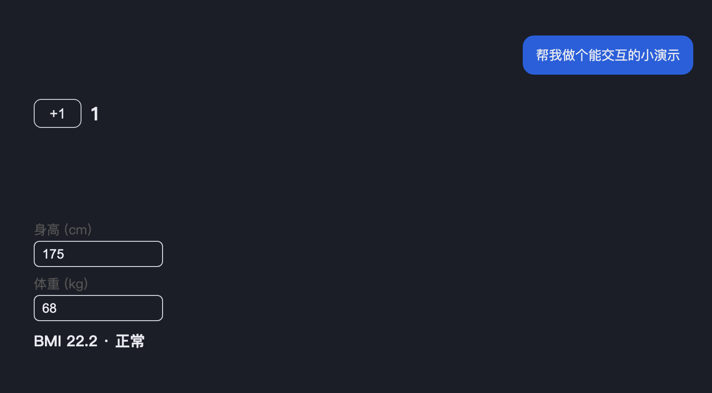

[English](README.md) | [简体中文](README.zh-CN.md)

# dsh-generative-ui

Let the AI output **interactive HTML components** (Generative UI) directly in
the DSH chat flow.

The agent writes a fenced code block in its reply:

````md
```generative-ui
<!-- title: Example: counter -->
<button id="plus">+1</button> <span id="n">0</span>
<script>let n=0;plus.onclick=()=>{n++;n.textContent=n}</script>
```
````

The plugin extracts every artifact from that turn and renders it as a sandboxed
card below the message: an `<iframe sandbox="allow-scripts">` (no same-origin)
— the artifact is fully interactive, but can never touch the host page,
cookies, or local storage.

## Design

- **Pure client-side: no backend, no storage.** Artifacts live in the session
  message text — the session is the store; there is no second copy of state
  and nothing to sync.
- The host half does one thing: broadcast the fenced-block convention to every
  agent via `systemPrompt.section`.
- The browser half uses a `uiConversation.events` accumulator to extract
  artifacts from `assistant/message` events (the same turn-accumulator pattern
  as dsh-taskboard), projects them onto the turn location, and renders the
  cards through the `conversation.chat.turnTail` slot.
- Adaptive height: a bootstrap injected into each artifact reports its height
  to the parent via ResizeObserver + postMessage; cards are clamped between
  120–600px and scroll internally beyond that.

## Layout constraints

An artifact is a bare iframe document: no font, no spacing reset, no surface. Every artifact document therefore gets a design system inlined into `<head>` (`DESIGN_SYSTEM_CSS`), so constrained generation is enforced at runtime rather than merely requested in the prompt:

- **Separate regions with surfaces, not borders.** `--gui-surface-1/2/3` is a three-step surface ramp; `--gui-tint` / `--gui-tint-strong` are accent washes.
- **Three type sizes, no more.** `--gui-fs-title`(18) / `--gui-fs-body`(14) / `--gui-fs-caption`(12); hierarchy comes from weight and `--gui-fg-dim`, not from 1.08-ratio size steps.
- **Spacing and radius are tokens only.** `--gui-gap`(12) / `--gui-pad`(16), radius `--gui-radius`(12) / `--gui-radius-sm`(8); chips stay fully round.
- **Outer spacing is reset.** `html,body{margin:0!important;padding:0!important}` keeps artifacts flush with the message column; inner blocks own their spacing.
- **A typography baseline.** System font stack, 14px/1.7, an 11–17px size scale — no browser-default serif.
- **Utilities**: `.gui-stack` `.gui-section` `.gui-section--tint` `.gui-card` `.gui-tint` `.gui-chip` `.gui-chip--on` `.gui-label` `.gui-title` `.gui-desc` `.gui-note` `.gui-grid`.
- **Interaction and motion built in.** `button` ships with the primary style, `:active` scale, `:focus-visible` ring and 44px touch height; motion stays on `transform`/`opacity` under 200ms with `--gui-ease`, plus a `prefers-reduced-motion` fallback.
- **Audit**: `auditArtifactSource(source)` reports violations (`border` / `shadow` / `gradient` / `blur` / `body-spacing` / `comment` / `em-dash` / `buzzword` / `pure-color`) without blocking the render.

The same rules travel to the model as text in `GENERATIVE_UI_GUIDANCE`.

## Install

```sh
dsh plugin --profile desktop add link:<this-directory>
# and add @ttmouse/dsh-generative-ui to dsh.profile.bundles in the profile
# package.json; restart the desktop app (the host half registers the prompt
# section; client.js is read from disk per request)
```

## Develop

```sh
npm install && npm run build       # produces lib/client.js + lib/index.mjs
npm test                           # unit + e2e (headless Chromium)
npm run screenshot                 # regenerate screenshot.png from the real client
```

Client changes take effect on page refresh; host-half changes (the
system-prompt text) need an app restart.

## License

MIT
